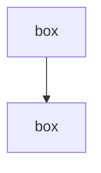

# Workmap: the file-backed diagram pane

The user's Diagrams side pane renders one mermaid file per pinned diagram from
`~/.claude/workmaps/<project>/` (project = the current directory's name). The pane
reloads a file within a second of any edit — yours, the user's, anyone's.

## The rules

1. **Edit the file, never re-emit.** When the user asks to change an existing
   diagram ("add a retry box", "rename the auth node"), read the pin's file
   (diagram_get lists each pin's file path) and edit it with your normal file
   tools. Do NOT write a new mermaid block in chat — that pins a *second*
   diagram.
2. **A genuinely new diagram** (the user asks for one that does not exist) may
   be drawn in chat as a fenced mermaid block; the pane materializes it to a
   new numbered file automatically. After that, rule 1 applies to it too.
3. **Anchors**: a line `click <id> "<path>:<line>"` inside the mermaid anchors
   a box to the code it stands for. Opening that box in the pane shows the
   referenced lines. Use relative paths from the project root, e.g.
   `click api["API layer"]` then `click api "src/api/router.go:42"`.
4. **Unpinning** is the user's call from the pane (it keeps the file, marked
   `<!-- workmap: unpinned -->`). Delete that first line to re-pin.

## File format

```markdown
# <title>

<!-- workmap: turn=N -->


```

Only the fenced mermaid block matters to the pane; keep the heading for the
pin's title. Numbers in filenames (`01-…`, `02-…`) order the pins, newest
first; don't renumber existing files.

## Before editing

Call `diagram_get` once to get current pin files and node ids — keep the ids of
boxes you don't change so the user's open view survives your edit.
